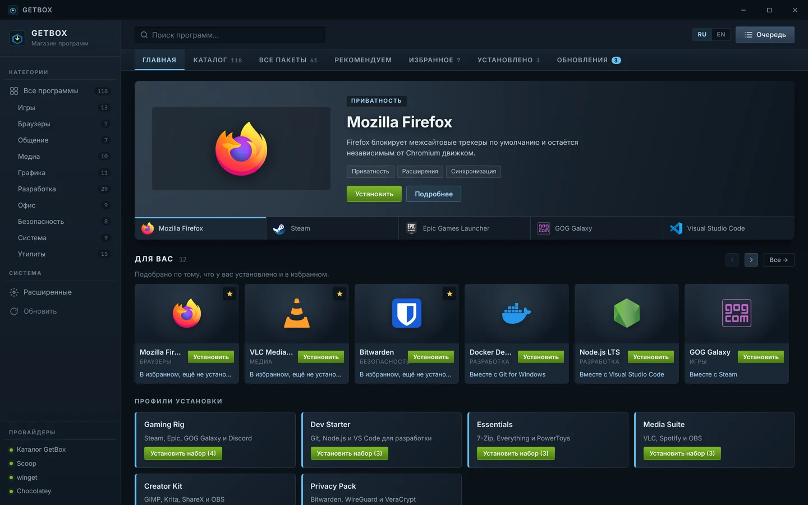
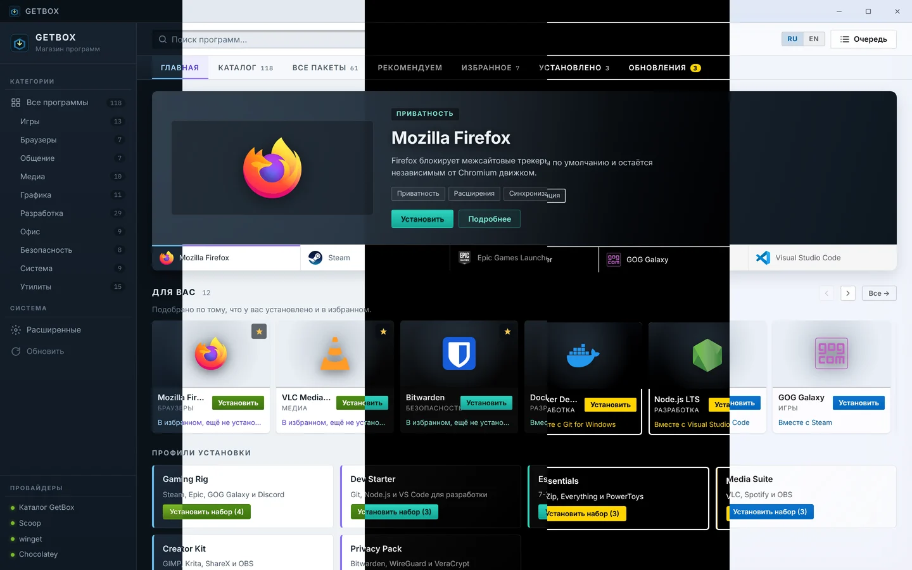
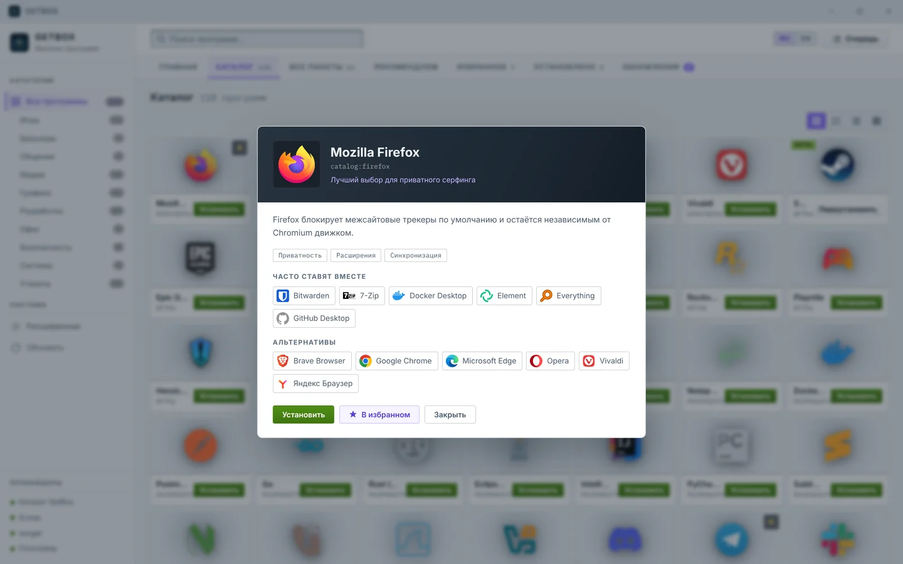
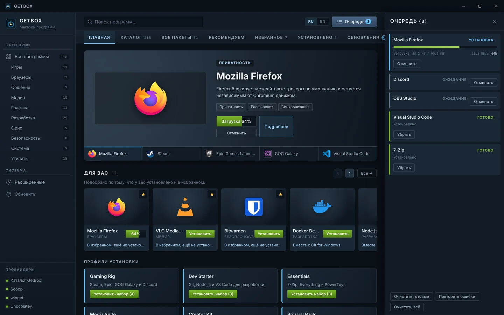
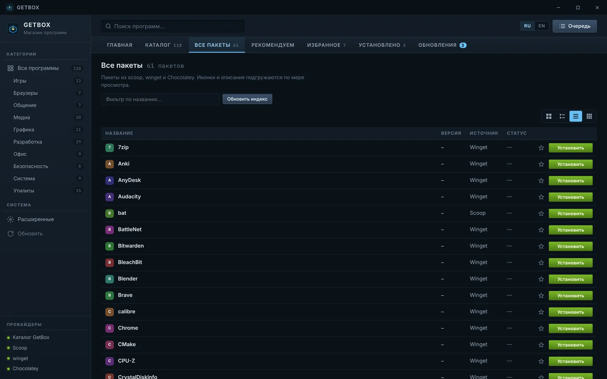
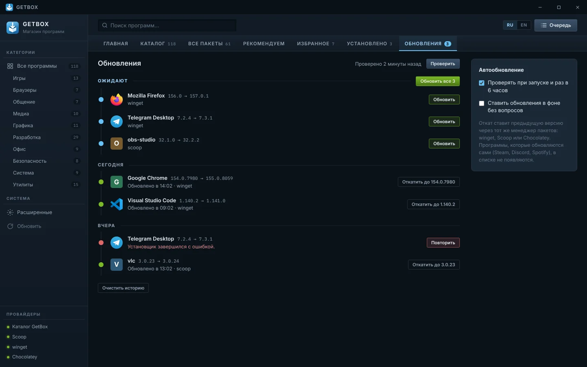
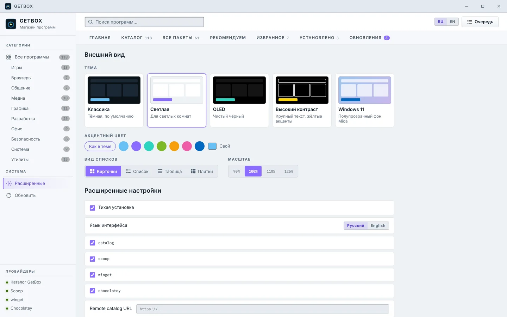

<p align="center">
  
</p>

<h1 align="center">GetBox</h1>

<p align="center">
  <b>Магазин программ для Windows.</b> Нашли, нажали «Установить» — дальше GetBox всё сделает сам.<br/>
  Официальные установщики, проверка SHA256, обновления и откат — в одном окне.
</p>

<p align="center">
  <a href="https://github.com/IncludeSpecial/GetBox/releases/latest"></a>
  <a href="https://github.com/IncludeSpecial/GetBox/releases"></a>
  <a href="https://github.com/IncludeSpecial/GetBox/actions/workflows/ci.yml"></a>
  
</p>

<p align="center">
  <a href="https://github.com/IncludeSpecial/GetBox/releases/latest"><b>⬇ Скачать GetBox</b></a>
  &nbsp;·&nbsp; <a href="#быстрый-старт">Быстрый старт</a>
  &nbsp;·&nbsp; <a href="#частые-вопросы">FAQ</a>
  &nbsp;·&nbsp; <a href="CHANGELOG.md">Что нового</a>
  &nbsp;·&nbsp; <a href="README.en.md">English</a>
</p>

<p align="center">
  
</p>

## Зачем

Обычно новая программа — это поиск сайта, проверка, что это не подделка, скачивание, «Далее → Далее → Готово» и снятие галочек с лишнего. GetBox делает это за вас:

- **берёт установщик с официального источника** — ссылки и контрольные суммы приходят из манифестов winget, а не из случайных зеркал;
- **проверяет файл до запуска** — только HTTPS, SHA256 должен совпасть, иначе установка не начнётся;
- **ставит тихо** — без мастеров и навязанных «дополнительных предложений»;
- **следит за обновлениями** всего, что установлено, и умеет откатить неудачное.

## Возможности

<table>
<tr>
<td width="50%" valign="top">

**Каталог с витриной**<br/>
Курируемые программы с описаниями и иконками по категориям: браузеры, игры, разработка, медиа, безопасность и другие. Каталог постоянно пополняется.

</td>
<td width="50%" valign="top">

**Все пакеты winget, Scoop и Chocolatey**<br/>
Тысячи пакетов из трёх менеджеров на отдельной вкладке. Менеджеры GetBox ставит сам при первом запуске — ничего настраивать не нужно.

</td>
</tr>
<tr>
<td valign="top">

**Обновления и откат**<br/>
Вкладка «Обновления» показывает, что устарело, — по одной или «Обновить все». В истории можно вернуть предыдущую версию.

</td>
<td valign="top">

**Профили и рекомендации**<br/>
Наборы в один клик (Gaming Rig, Dev Starter, Essentials…), лента «Для вас», «Часто ставят вместе» и «Альтернативы».

</td>
</tr>
<tr>
<td valign="top">

**Очередь установок**<br/>
Ставьте сразу несколько программ: прогресс, отмена, повтор и понятные ошибки на русском.

</td>
<td valign="top">

**Внешний вид под себя**<br/>
Пять тем (включая Windows 11 с Mica), свой акцентный цвет, масштаб 90–125 % и четыре вида списков.

</td>
</tr>
</table>

<p align="center">
  <br/>
  <sub>Классика · Светлая · OLED · Высокий контраст · Windows 11</sub>
</p>

## Быстрый старт

1. Скачайте **`GetBox-<версия>-portable.exe`** со страницы [последнего релиза](https://github.com/IncludeSpecial/GetBox/releases/latest).
2. Запустите файл. Установка не нужна — это portable-приложение, его можно держать где угодно (например, в `Документы` или на флешке).
3. Если Windows показала **«Windows защитила ваш компьютер»**, нажмите **«Подробнее» → «Выполнить в любом случае»**. Предупреждение SmartScreen появляется у новых приложений без платной подписи кода; проверить, что файл настоящий, можно по контрольной сумме (см. [FAQ](#частые-вопросы)).
4. Каталог открывается сразу. В фоне GetBox настраивает winget и Scoop — статус виден в левом нижнем углу.
5. Chocolatey по желанию: нажмите **«Разрешить установку»** (один запрос UAC) или **«Пропустить»**.

**Требования:** Windows 10 или 11 (x64), интернет для загрузки программ. Права администратора для самого GetBox не нужны.

## Как пользоваться

### Установить программу

Найдите её через поиск сверху или в каталоге и нажмите **«Установить»**. Карточка **«Подробнее»** покажет описание, источник и похожие программы.

<p align="center"></p>

Нажимать можно сразу на несколько программ — они встанут в **очередь** (кнопка «Очередь» справа сверху). Там видно прогресс, можно отменить загрузку, повторить неудачную установку или убрать ошибку.

<p align="center"></p>

### Поставить набор программ

На главной есть **профили установки** — готовые наборы под задачу: игры, разработка, офис, медиа, приватность. «Установить набор» добавит в очередь всё, чего у вас ещё нет. Программы можно добавлять в **избранное** (звёздочка) — по нему строится лента «Для вас».

### Найти то, чего нет в каталоге

Вкладка **«Все пакеты»** ищет по winget, Scoop и Chocolatey одновременно. Если программа есть в нескольких менеджерах, видно, откуда она поставится.

<p align="center"></p>

### Обновить установленное

Вкладка **«Обновления»** (число на ней — сколько доступно) собирает устаревшие программы из всех менеджеров. Нажмите **«Обновить»** у нужной или **«Обновить все»**.

- Ниже — **история по дням**. Если новая версия оказалась хуже, нажмите **«Откатить»**, и GetBox вернёт предыдущую.
- Справа можно включить **проверку при запуске и раз в 6 часов** и **фоновую установку обновлений** без вопросов.

<p align="center"></p>

### Настроить внешний вид

**Расширенные → Внешний вид**: тема, акцентный цвет, масштаб интерфейса и вид списков (карточки, список, таблица, плитки). Вид списка также переключается кнопками над каждым списком. Язык интерфейса (RU / EN) — переключатель в заголовке окна.

<p align="center"></p>

### Обновлять сам GetBox

Начиная с 1.3.0 GetBox обновляется сам. Новая версия скачивается в фоне и сверяется по SHA256, после чего в заголовке окна появляется кнопка **«Обновить до X»**: перезапустить сейчас или обновиться при выходе. После обновления покажется экран **«Что нового»**.

Канал (**Стабильный** / **Бета**), ручная проверка и фоновая загрузка — в **Расширенные → GetBox**.

> С версий 1.2.x на 1.3.0 нужно перейти один раз вручную: скачайте новый exe и замените им старый. Настройки и избранное сохранятся.

## Частые вопросы

<details>
<summary><b>Это безопасно? Откуда берутся программы?</b></summary>

Программы каталога скачиваются по прямым ссылкам издателей из официального индекса winget (тот же источник, что у `winget install`). GetBox качает только по HTTPS, сверяет SHA256 из манифеста и лишь потом запускает установщик; если что-то не совпало, он переключается на установку через winget. Пакеты из «Всех пакетов» ставят сами winget, Scoop и Chocolatey со своими проверками.
</details>

<details>
<summary><b>Как проверить, что файл настоящий?</b></summary>

Рядом с exe в каждом релизе лежит файл `.sha256`. Сравните его содержимое с выводом PowerShell:

```powershell
Get-FileHash .\GetBox-1.3.0-portable.exe -Algorithm SHA256
```

Хеши должны совпасть до символа. Тот же хеш показывает GitHub на странице релиза рядом с файлом.
</details>

<details>
<summary><b>Нужны ли права администратора?</b></summary>

Нет. Не запускайте GetBox «от имени администратора» постоянно: установщик Scoop отказывается работать в такой сессии. Отдельные программы сами попросят UAC при установке, а Chocolatey — один раз, при включении.
</details>

<details>
<summary><b>Программа не ставится — что делать?</b></summary>

Откройте очередь: у ошибки есть понятное описание (нет сети, файл не найден, блокировка по региону, таймаут) и кнопка **«Повторить»**. Если блокирует регион или CDN, попробуйте другой источник той же программы на вкладке «Все пакеты». Если не помогло — [создайте issue](https://github.com/IncludeSpecial/GetBox/issues/new) с текстом ошибки.
</details>

<details>
<summary><b>Что не так с winget на старой Windows 10?</b></summary>

winget входит в «Установщик приложений» (App Installer). На старых сборках Windows 10 его нужно обновить из Microsoft Store. Каталог и Scoop работают и без winget.
</details>

<details>
<summary><b>Где GetBox хранит данные и как его удалить?</b></summary>

Всё лежит в `%LOCALAPPDATA%\GetBox\`: изолированные Scoop и Chocolatey, кэш иконок и описаний, настройки, история обновлений. Чтобы удалить GetBox полностью, закройте его, удалите exe и эту папку. Программы, установленные через GetBox, останутся — удалить их можно как обычно, через «Параметры → Приложения».
</details>

## Обратная связь

- Нашли ошибку или не хватает программы в каталоге — [откройте issue](https://github.com/IncludeSpecial/GetBox/issues/new).
- История изменений — в [CHANGELOG.md](CHANGELOG.md) и на странице [Releases](https://github.com/IncludeSpecial/GetBox/releases).
- Хотите собрать GetBox сами или добавить программу в каталог — читайте [docs/DEVELOPMENT.md](docs/DEVELOPMENT.md).

<p align="center"><sub>Electron · React · TypeScript · Vite</sub></p>
